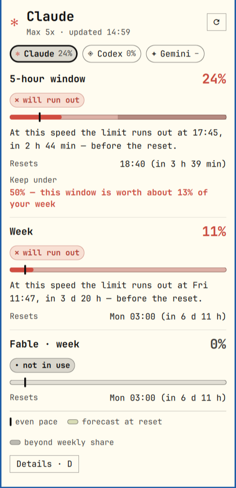

# AI limits for the Omarchy bar

Usage limits of the AI tools on your machine — **Claude, Codex and Gemini** — in the
[Omarchy](https://omarchy.org) bar, with a switch between them. Each window gets a
plain-language verdict instead of a wall of numbers, plus a pace meter and a forecast.
Built to be read by people with low vision.

[Русская версия](README.ru.md)



In the bar: `✻ [meter] 9% 4h22m W9%` — the selected AI's mark and meter in a pace colour,
the percent used, the time to reset, and a chip when a longer window needs attention.
Left click opens the popup, **middle click switches to the next AI**, right click refreshes.
Only tools that are signed in on this machine appear.

## Why another limit widget

- **It tells you what to do.** Each window starts with one sentence: *"At this speed
  the limit runs out at Fri 17:12, in 4 d 2 h — before the reset."* Details (`D`) are one key away.
- **It protects the long window, not only the short one.** The 5-hour window gets a ceiling
  derived from what is left of the week, so burning every window to 100% doesn't leave you
  locked out on Thursday.
- **Real numbers from every device.** Each AI is asked on the provider's side, the same
  figures its own CLI shows, so work on other machines counts.
- **Accessible.**
  - text is never smaller than 13 px and scales (`textSize`: Normal, Large, Extra large);
  - every text colour is held to WCAG AA contrast (4.5:1) on your theme's popup background —
    checked against the colours of all 22 stock Omarchy themes;
  - status is a word *and* a shape (✓ ▲ ✕), never colour alone;
  - the popup scrolls instead of clipping when the text is large;
  - `animations: false` stops the meters from sliding.
- **English and Russian** (`language`: `auto` follows your locale).

## Supported AIs

| AI | Where the numbers come from | What you see | Login |
|---|---|---|---|
| **Claude** | Anthropic's OAuth usage endpoint (what `/usage` shows) | 5-hour window, week, model weeks (e.g. Fable) | Claude Code |
| **Codex** | the `codex app-server` RPC `account/rateLimits/read`, run read-only | its 5-hour / weekly windows, or the single long window of free and Go plans | Codex CLI |
| **Gemini** | Google Code Assist `retrieveUserQuota` | daily quota per model family: Pro, Flash, Flash Lite | Gemini CLI (Google login) |

Each tool must be signed in with its own CLI. Windows of any length are handled: a window
up to 6 hours is paced in clock time, a longer one (a day, a week, 30 days) over your
active hours.

**Status:** Claude and Codex are used daily and checked against live accounts. Gemini is
written to the documented API and covered by tests on its response shape, but has not yet
been confirmed against a live account — please open an issue if its numbers look wrong.

## Requirements

- Omarchy with the shell plugin system (`omarchy plugin` exists).
- `python3` 3.8+ (standard library only).
- At least one of: Claude Code (Pro/Max login), Codex CLI, Gemini CLI (Google login).
  API-key logins have no subscription limits to show.

## Install

```bash
omarchy plugin add https://github.com/ismoil77/omarchy-ai-limits.git --enable
```

(or copy the folder to `~/.config/omarchy/plugins/ismoil.ai-limits/`, run
`omarchy-shell shell rescanPlugins`, then `omarchy plugin enable ismoil.ai-limits`).

Plugins run unsandboxed inside the shell — read the code first; it is small.
Update with `omarchy plugin update ismoil.ai-limits`.

## Use

- **Bar:** left click — popup; middle click — next AI; right click — refresh.
- **Popup:** chips at the top switch AI (click, `h`/`l`, or `1`–`3`); `d` toggles details;
  `r` refreshes; `Esc` closes. IPC: `omarchy-shell ismoil.ai-limits next|previous|select <id>|refresh|toggle`.

## Remove

```bash
omarchy plugin remove ismoil.ai-limits
rm -rf ~/.cache/ismoil-ai-limits      # cached numbers, optional
```

## Settings

Set in the widget's entry in `~/.config/omarchy/shell.json`, or in the shell's bar settings:

| key | default | |
|---|---|---|
| `providers` | `all` | `all`, or a list such as `claude,codex` |
| `language` | `auto` | `auto`, `en`, `ru` |
| `textSize` | `Normal` | `Normal`, `Large`, `Extra large` — scales popup and bar text |
| `workFrom`, `workTo` | `8`, `23` | Hours of your local day you use AI. Windows of a day or more are paced over these hours only, so nights don't make you look slow. `0`–`24` for round the clock |
| `clock` | `24-hour` | or `12-hour` |
| `animations` | `true` | `false` stops the meters from sliding |
| `renewLogin` | `false` | `true`: renew an expired **Claude** login by itself (see Privacy) |
| `interval` | `60` | refresh seconds (at least 45); Codex and Gemini are asked at most every 2 minutes |

## Privacy and what it touches

Read this: the widget handles your AI logins.

- **Claude:** reads `~/.claude/.credentials.json` (or `$CLAUDE_CONFIG_DIR`) and sends the
  access token **only** to `https://api.anthropic.com/api/oauth/usage`.
- **Codex:** the widget never reads Codex's tokens. It starts `codex app-server` (read-only
  sandbox, as Omarchy's own agents panel does) and asks it for the limits; Codex handles its own login.
- **Gemini:** reads the access token in `~/.gemini/oauth_creds.json` and sends it **only** to
  `https://cloudcode-pa.googleapis.com/v1internal` (`loadCodeAssist`, `retrieveUserQuota`).
  It never refreshes Google's token; when it has expired the widget says so and waits for you to run `gemini`.
- **Off by default: the Claude login file is never written.** When Claude's access token
  expires the widget shows "sign-in expired — run claude" and waits until Claude Code refreshes it.
- **Opt-in `renewLogin: true`.** Then, when Claude's access token has expired (or is rejected),
  the widget renews it the way Claude Code does: the refresh token goes **only** to
  `https://platform.claude.com/v1/oauth/token`, and the new pair is written back to
  `.credentials.json` (atomically, same permissions, other keys kept). A failed renewal is not
  retried for 10 minutes. Because the refresh token rotates, a Claude Code session that was already
  running may need `claude` restarted once if it had cached the old pair.
- Nothing else leaves your machine. Cached numbers live in `~/.cache/ismoil-ai-limits/`.

## How the colours are decided

- **green** — on or under an even pace, nothing suggests running out before the reset.
- **yellow** — faster than an even pace, near the limit, or past this window's share of the longer window.
- **red** — at the current speed it runs out before the reset (or already spent).
  A high percent alone is not red: 92% with nothing being spent is fine.

## Development

```bash
tests/run.sh      # Python, Node, Qt's QML engine, and `omarchy plugin validate`
```

`limit.py` is the data layer (one fetcher per AI, one state file each), `Model.js` the pace
maths and every sentence, `Strings.js` the en/ru text, `kit/` the shared colour fixing and translation helpers (a copy of
[omarchy-widget-kit](https://github.com/ismoil77/omarchy-widget-kit)). The last
three are pure functions loaded both by the widget and by the tests. The Qt 6 `qmltestrunner` suite is
skipped if it isn't installed. After changing QML, run `omarchy restart shell` — hot reload can leave
a stale widget.

**Add an AI:** write a `fetch_<id>(state, now, renew)` in `limit.py` that returns
`{"windows": [...], "plan": "..."}` (see `make_window`) or raises `Failure(kind)`, register it in
`PROVIDERS`, `FETCHERS`, `DETECTORS`, give it a mark in `Widget.qml`'s `markOf`, and add tests.
**Add a language:** add a table to `Strings.js` (the tests fail until it has every key and the same
placeholders) and its code to `LANGS`.

## License

MIT
