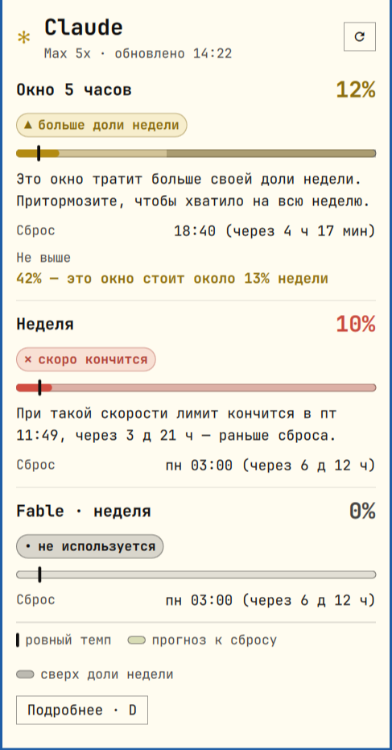

# Лимиты Claude в панели Omarchy

Лимиты Claude в панели [Omarchy](https://omarchy.org): окно 5 часов, неделя и
недельные лимиты отдельных моделей. Вместо стены цифр — понятный вывод простыми словами.
Сделано так, чтобы читалось людям со слабым зрением.

[English version](README.md)



В панели: `✻ [полоса] 9% 4ч22м н9%` — звезда и полоса показывают окно 5 часов в цвете
темпа, дальше время до сброса; рядом появляется метка, когда недели нужно внимание.
Левый клик открывает окно, правый — обновляет.

## Чем отличается

- **Говорит, что делать.** Каждое окно начинается с одной фразы: *«При такой скорости
  лимит кончится в пт 17:12, через 4 д 2 ч — раньше сброса.»* Остальные цифры — по клавише `D`.
- **Бережёт неделю, а не только окно.** У окна 5 часов есть потолок, посчитанный по
  остатку недели: если выжимать каждое окно до 100%, в четверг не останется ничего.
- **Настоящие цифры со всех устройств.** Берёт их с сервера Anthropic — те же, что в
  `/usage`, — поэтому работа на других компьютерах учитывается.
- **Доступность.**
  - текст не мельче 13 px и масштабируется (`textSize`: Normal, Large, Extra large);
  - цвет любого текста доводится до контраста WCAG AA (4,5:1) на фоне окна вашей темы —
    проверено на цветах всех 22 стандартных тем Omarchy;
  - статус — это слово и значок (✓ ▲ ✕), а не только цвет;
  - при крупном тексте окно прокручивается, а не обрезается;
  - `animations: false` отключает «плавание» полос.
- **Русский и английский** (`language`: `auto` — по языку системы).

## Что нужно

- Omarchy с системой плагинов шелла (есть команда `omarchy plugin`).
- `python3` 3.8+ (только стандартная библиотека).
- Claude Code, в который вы вошли по подписке Claude (Pro/Max). У входа по API-ключу
  лимитов подписки нет.

## Установка

```bash
omarchy plugin add https://github.com/<you>/omarchy-claude-limit.git --enable
```

Плагины выполняются в шелле без песочницы — сначала прочитайте код, он небольшой.
Обновление: `omarchy plugin update ismoil.claude-limit`.

## Удаление

```bash
omarchy plugin remove ismoil.claude-limit
rm -rf ~/.cache/ismoil-claude-limit      # кэш цифр, по желанию
```

## Настройки

В записи виджета в `~/.config/omarchy/shell.json` или в настройках панели:

| ключ | по умолчанию | |
|---|---|---|
| `language` | `auto` | `auto`, `en`, `ru` |
| `textSize` | `Normal` | `Normal`, `Large`, `Extra large` — размер текста в попапе и панели |
| `workFrom`, `workTo` | `8`, `23` | Часы местного времени, когда вы пользуетесь Claude. Темп недели считается только по ним, чтобы ночи не делали вас «медленным». `0`–`24` — круглосуточно |
| `clock` | `24-hour` | или `12-hour` |
| `animations` | `true` | `false` отключает анимацию полос |
| `interval` | `60` | период обновления, секунды (не меньше 45) |

## Приватность и что трогает плагин

Важно: виджет работает с вашим входом в Claude.

- Читает `~/.claude/.credentials.json` (или `$CLAUDE_CONFIG_DIR`) и отправляет токен
  доступа **только** на `https://api.anthropic.com/api/oauth/usage`.
- **Когда токен доступа истёк** (или сервер его отклонил), плагин обновляет его так же, как
  Claude Code: refresh-токен уходит **только** на `https://platform.claude.com/v1/oauth/token`,
  а новая пара токенов записывается обратно в `.credentials.json` (атомарно, с теми же
  правами, остальные ключи сохраняются). Раньше виджет ждал, пока вы запустите `claude`.
  Неудачное обновление не повторяется 10 минут.
- Больше ничего не покидает компьютер. Кэш цифр — в `~/.cache/ismoil-claude-limit/`.

## Как выбирается цвет

- **зелёный** — темп ровный или медленнее, до сброса лимит не кончится.
- **жёлтый** — быстрее ровного темпа, близко к лимиту или больше доли недели.
- **красный** — при текущей скорости лимит кончится раньше сброса (или уже исчерпан).
  Один лишь высокий процент красным не бывает: 92% при нулевых тратах — это нормально.

## Разработка

```bash
tests/run.sh      # Python, Node, QML-движок Qt и `omarchy plugin validate`
```

`Model.js` (расчёты и все фразы), `Strings.js` (en/ru), `Contrast.js` — чистые функции,
их используют и виджет, и тесты. Набор тестов на Qt 6 `qmltestrunner` пропускается, если
его нет. После правок QML запускайте `omarchy restart shell` — горячая перезагрузка
иногда оставляет старый виджет.

Новый язык: добавьте таблицу в `Strings.js` (тесты не пройдут, пока нет всех ключей и тех
же подстановок) и код языка в `LANGS`.

## Лицензия

MIT
